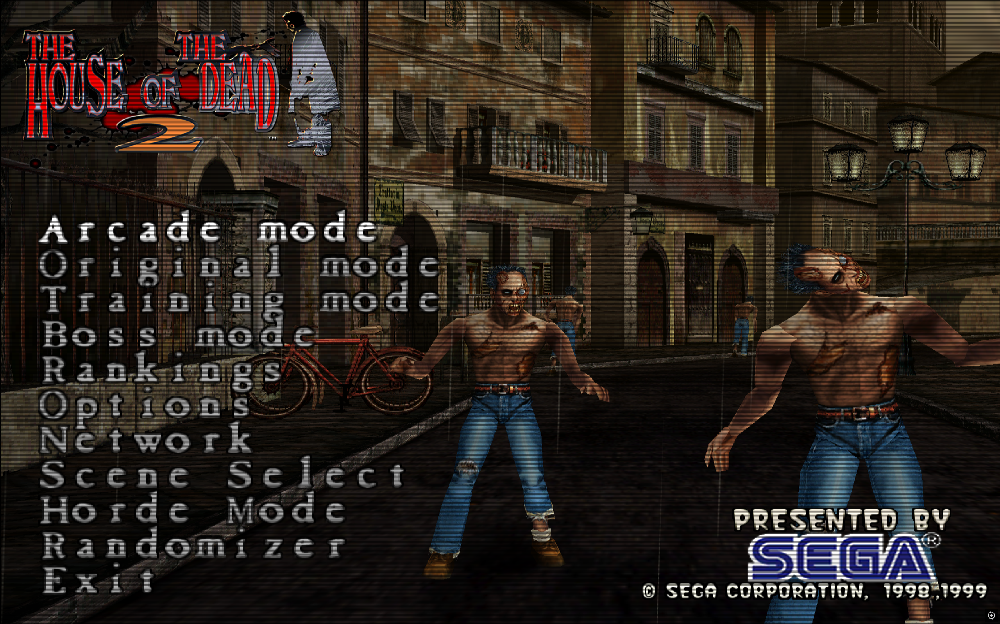

# HOTD2RE

A native C++20 rebuild of **The House of the Dead 2** for Windows, featuring online co-op, additional game modes, and modern controls and display options.

**[Download the game](https://github.com/GitFist/hotd2-re/releases/latest)** · **[Optional 2× graphics pack](https://github.com/GitFist/hotd2-re/releases/download/v2026.10.16-r/hotd2re-graphics-2x.zip)**

## Features

- **Game modes:** Arcade, Original, Training, Boss, Scene Select, and Horde.
- **Randomizer:** randomized enemies, enemy counts, weapons, items, voice lines, and character appearances.
- **Online co-op:** two-player rooms, public lobbies, private room codes, and reconnect support.
- **Flexible controls:** mouse, touchpad, touch, in-game light-gun setup for two players, and native Wii Remote setup with calibration and button mapping. Menus support clicking and shooting.
- **Night Shift menus:** moving standby background, Home lobby preview, Play/Practice pages, leaderboards, graphics options, pause and device setup. Classic menus remain selectable.
- **Graphics options:** fullscreen/windowed display, AA and texture filtering, render scaling, optional lighting effects, CRT, red/green blood and separate optional 2× textures. Supported x64 hardware can use vendor upscaling/frame generation and experimental ray shadows.
- Graphics reset, menu opacity, Hide UI for live inspection, and saved gameplay crosshair visibility. The system mouse cursor hides during play; manual pause remains available while switching windows keeps the game and sound running.
- Chapter results and an experimental Prototype chapter, available with **F8**.
- Background update notifications at the title/main menu, with a link to the official download page.

## Getting started

**Requirements:** Windows 10 or 11 (64-bit) and a Direct3D 11-compatible graphics device for the main download. Optional Direct3D 12/vendor features require compatible hardware; the separate x86 build has fewer advanced graphics features.

1. Download **hotd2re-multiplayer-complete.zip** from the [latest release](https://github.com/GitFist/hotd2-re/releases/latest).
2. Extract the ZIP to a writable folder.
3. Open the `hotd2re` folder and run **hotd2.exe**.

The download includes the required game data. Keep the `game` and `scenes` folders beside `hotd2.exe`. GitHub's **Source code** archives are for building the project.

Build A adds Night Shift menus and optional modern graphics, room cancellation fixes, graphics reset, crosshair/cursor controls and updated Wii/light-gun pages. It also fixes sound on launches with custom game paths or options. The creature, Emperor, smoke, scenery and skipped-dialogue corrections from Build Z remain included; see the [graphics fixes and validation](docs/GRAPHICS-FIXES.md).

## Updates

The game checks the official GitHub release page once in the background on normal launches. If a newer build is available, a prompt appears at the local title/main menu. Choose **Open download page** or **Later**. Downloads and installation are manual; failed checks stay silent. Launch with `--no-update-check` to disable the check.

Close the game and extract the **entire new ZIP into a fresh writable folder**. Keep the new executable, accompanying DLLs, licenses and `scenes` together. Replacing only the executable can leave incompatible older runtimes installed.

Before launching, copy your existing `hotd2re_settings.ini`, `hotd2re_save.bin`, and any `hotd2re_horde_records.txt`, `hotd2re_lightguns.ini` and `hotd2re_wii.ini` into the new `hotd2re` folder, replacing its supplied default settings. Copy installed visual-pack folders if your settings select them. Keep the old folder as a backup until you have checked the new version. Both online players should update together and create a new room.

## Online play

Both players need the same game version.

1. Use **Host Online** on Home to host, or **Online** to open network choices. Classic menus use **Network**.
2. Choose room rules to host, or **Browse Lobby** to join a room.
3. For a private room, enter its code when prompted. **Peer to Peer** also supports joining an unlisted room by code.
4. Once both players are connected, the host selects a mode and starts the game.

Use **Pause → Return to Lobby** to choose another mode together. After a disconnect, select **Network → Rejoin Game** to return to an active match while the other player continues playing.

Connections use a direct route when available, with an automatic server relay fallback.

Home's **Leaderboard** page offers local Arcade, Original, Horde and individual Boss Mode records. Shared records are unverified and publishing a new run is manual. The public rankings service update is pending deployment, so shared queries/publishing may be unavailable until the matching service is installed. Local records work offline.

## Controls

| Action | Default control |
| --- | --- |
| Aim | Mouse or light gun |
| Fire / select | Left click or gun trigger |
| Reload | Right click or gun reload button |
| Confirm / start | Enter |
| Skip ending credits | Left click, gun trigger, or Enter |
| Pause / resume | Esc |
| Navigate menus | Arrow keys, mouse, or gun aim |
| Back | Esc or Backspace |
| Quit | Main menu **Exit** or close the window |

Open **Options > Game Options > Light Guns** or **Pause > Light Guns** to switch between mouse/touchpad input and light guns, assign Player 1 and Player 2, remap buttons, calibrate aim, and test both guns. Classic menus retain **Options > Light Guns**. See the [light-gun setup guide](docs/LIGHT-GUNS.md).

Choose **Blood Color: Green / Red** on the graphics menu's **Color** page. The change applies immediately and is saved locally; online players can choose independently.

**Image > Gameplay Crosshairs > Off** hides both players' gameplay sights on this computer. Menu/shop/calibration pointers stay visible and aiming/shooting are unchanged. The system '+' pointer hides automatically during gameplay and returns for UI and desktop use.

Switching to another window keeps the game and audio running. Use **Esc** to pause manually when needed; online manual pause stops the shared game. Background desktop input does not shoot or operate the game's menus.

## Graphics and display

Open a graphics shortcut under **Options**, or **Pause > Graphics Options**. Both menu themes provide the same nine categories: **Display, Image, Lighting, Performance, Packs, Color, Resolution, CRT and Advanced**. Availability depends on the active renderer, GPU and installed pack.

**Display** contains windowed/borderless/exclusive fullscreen, aspect ratio, Fit/Stretch, monitor, menu style, opacity and **Reset All Graphics**. Reset asks for confirmation and preserves your pack, menu theme, game rules, audio and controls. Menu Style applies after restart. Menu Opacity controls Night Shift panels; Classic labels it “Night Shift only.”

**Image** contains presets, MSAA/post AA/TAA, texture filtering, Sharp HUD, sharpening and crosshairs. Original/Clean/Enhanced presets change image choices and downsampling; they do not reset every graphics setting. **Resolution** contains internal render scale, output matching/SSAA, dynamic resolution, downsampling and FSR 1 spatial upscaling. **Color** provides color controls, blood color, HDR and black/white/gamma/geometry test patterns. **CRT** contains scanlines, phosphor masks, curvature and glow.

**Lighting** adds optional pixel lighting, smoke blending, contact shading, raster/ray shadows, bloom, fog, reflections and cutscene blur. Direct3D 11 and SDL GPU provide the broad raster-effects paths. Native Direct3D 12 on Windows x64 supports compatible vendor reconstruction/frame generation and experimental directional DXR shadows; it does not support every D3D11/SDL effect. HDR requires Windows HDR and retains the original art's SDR range. Material detail and model smoothing under **Packs** need a compatible authored pack.

**Performance** contains frame limits, VSync, supported tearing/latency controls and statistics. **Advanced** contains renderer, vendor upscaling, quality, frame generation and pose interpolation. Renderer/vendor choices require restart. Pose interpolation above 60 FPS adds up to one tick of visual delay; game logic stays at 60 Hz. Advanced effects, HDR, ray shadows and frame generation are optional and Off by default.

While changing graphics during a paused game, **Hide UI / H** reveals the actual scene without resuming. H, Show UI, Back/Reload, Enter or Start restores the menu.

## Wii Remotes

Open **Options > Game Options > Wii Remotes** or **Pause > Wii Remotes** to connect and configure up to two remotes. Classic menus retain **Options > Wii Remotes**. Use a powered sensor bar with a compatible Bluetooth adapter, or a DolphinBar in Mode 4. See the [setup and calibration guide](docs/WII-REMOTES.md). Native support has automated tests; physical Wii Remote pairing/aiming remains unverified.

## Optional 2× graphics

The [2× graphics pack](https://github.com/GitFist/hotd2-re/releases/download/v2026.10.16-r/hotd2re-graphics-2x.zip) upgrades textures and menu graphics. Install it after the base game.

1. Close the game and extract **hotd2re-graphics-2x.zip**.
2. Copy its contents into the `hotd2re` folder, alongside `hotd2.exe`.
3. Run **Play with 2x Graphics.cmd**.

```text
hotd2re/
  hotd2.exe
  game/
  scenes/
  Play with 2x Graphics.cmd
  remaster-2x/
    tex/
    bmp/
```

To use the pack when launching `hotd2.exe` directly, add `assets=remaster-2x` to `hotd2re_settings.ini`. Remove that setting to return to the default graphics.

For sharper rendering, increase **Render Scale** under **Graphics Options → Resolution**. This draws more pixels at runtime and needs no pack or large download; the 2× texture pack replaces artwork separately. Each online player can choose their own graphics settings. Additional setup and removal instructions are included in **INSTALL-2X-GRAPHICS.txt**.

## Development

HOTD2RE uses C++20 and SDL3, with Direct3D 11, SDL GPU and optional native Direct3D 12 rendering. Windows x86 and x64 builds are supported; advanced vendor reconstruction/frame generation requires the x64 build and compatible hardware.

- [Build and test guide](docs/DEVELOPMENT.md)
- [Lobby server setup](server/lobby/README.md)
- [Report a bug](https://github.com/GitFist/hotd2-re/issues)

## License and credits

HOTD2RE is an independent fan project. **The House of the Dead 2** and its original game assets belong to Sega.

Original project code is available under the [MIT license](LICENSE). Game assets and other third-party material retain their respective licenses and copyright notices.

Built with [SDL](https://github.com/libsdl-org/SDL) (zlib license). The comparison tools use [Microsoft Detours](https://github.com/microsoft/Detours) (MIT license).

