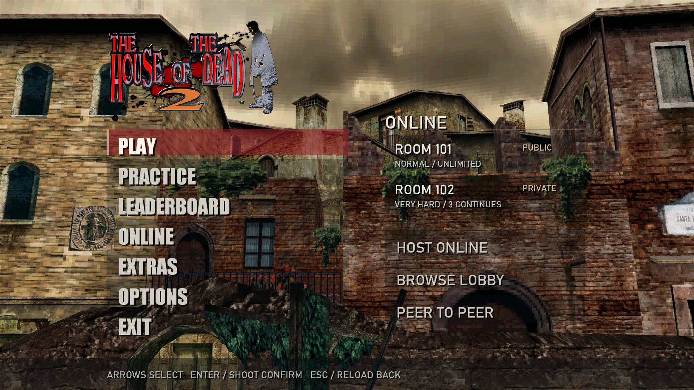
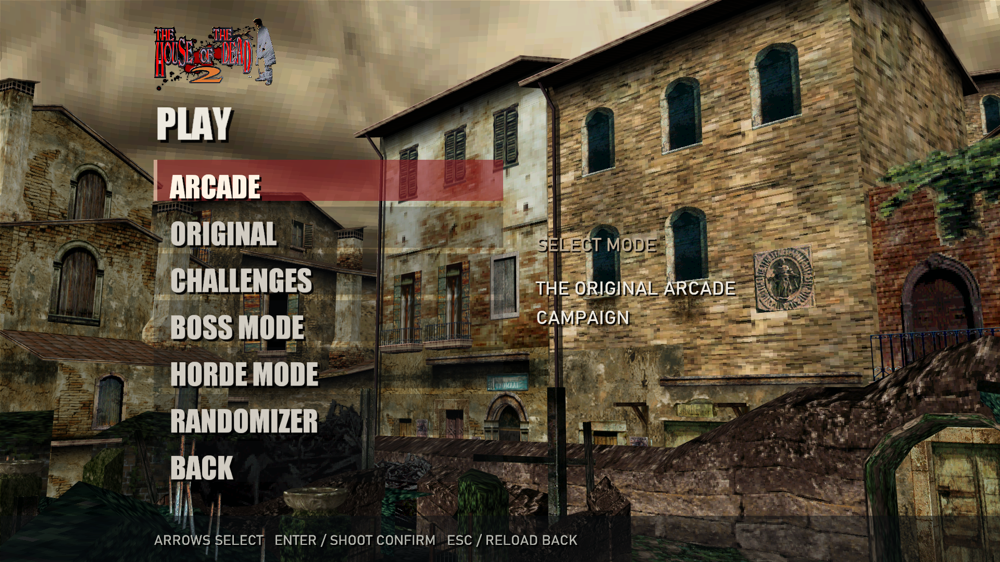
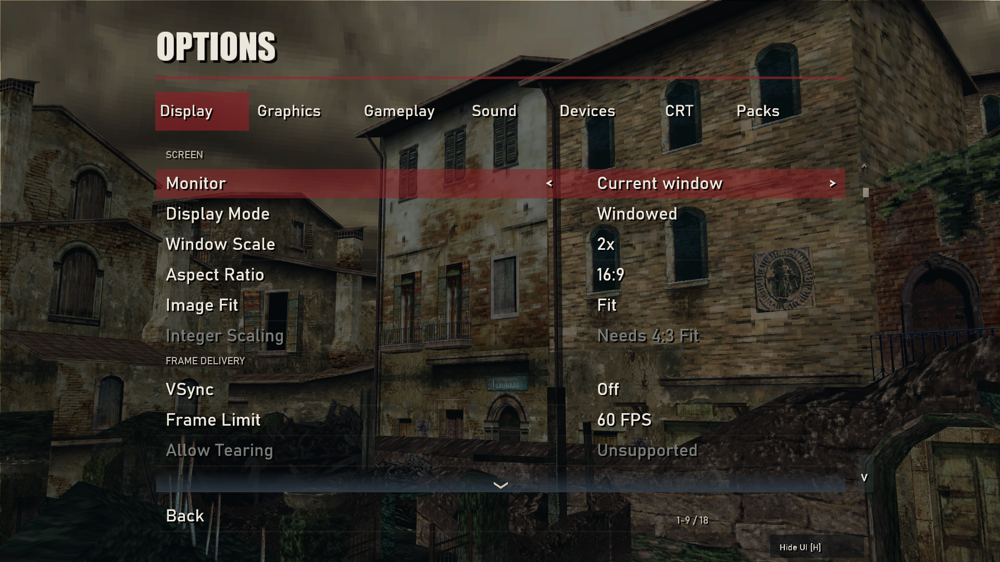
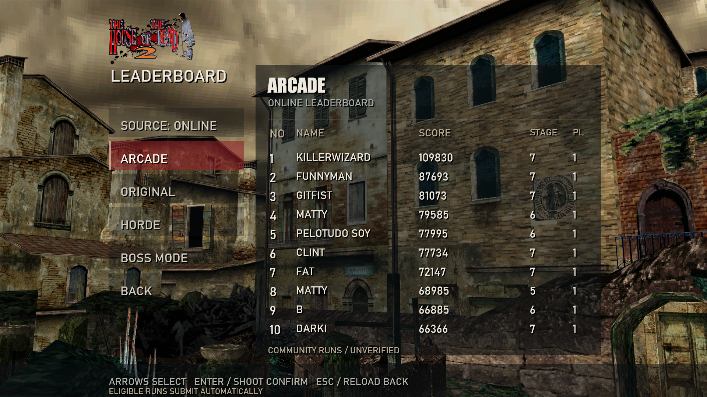

# HOTD2RE

A native C++20 rebuild of **The House of the Dead 2** for Windows, featuring online co-op, additional game modes, and modern controls and display options.

**[Download 1.5 for Windows x64](https://github.com/GitFist/hotd2-re/releases/download/v2026.10.27-b/HOTD2RE-1.5-Windows-x64.zip)** · [Release notes](https://github.com/GitFist/hotd2-re/releases/latest) · **[Optional 2× graphics pack](https://github.com/GitFist/hotd2-re/releases/download/v2026.10.16-r/hotd2re-graphics-2x.zip)**

## Features

- **Game modes:** Arcade, Original, Challenges (formerly Training), Boss, Scene Select, and Horde.
- **Randomizer:** randomized enemies, enemy counts, weapons, items, voice lines, and character appearances.
- **Online co-op:** two-player rooms, public lobbies, private room codes, and reconnect support.
- **Flexible controls:** mouse, touchpad, touch, in-game light-gun setup for two players, and native Wii Remote setup with calibration and button mapping. Menus support clicking and shooting.
- **Night Shift menus:** the full original attract cycle plays behind the menus, including the title flythrough, how-to-play demonstration, gameplay demos and story scenes. Includes Home lobby preview, Play/Practice pages, leaderboards, graphics options, pause and device setup. Classic menus remain selectable.
- **Extras audio library:** all 38 music tracks with descriptive names and Standard/Alternate version labels on the left, effects and dialogue on the right. Browse independently while recordings play once, with Play, Pause and Reset controls for each song.
- **Extras model viewer:** browse game models and animations, rotate and zoom the view, and preview available character sound variations.
- **Graphics options:** fullscreen/windowed display, AA and texture filtering, render scaling, optional lighting effects, CRT, red/green/blue/purple blood and separate optional 2× textures. Supported x64 hardware can use vendor upscaling/frame generation and experimental ray shadows.
- Graphics reset, menu opacity, Hide UI for live inspection, and saved gameplay crosshair visibility. The system mouse cursor hides during play; manual pause remains available while switching windows keeps the game and sound running.
- Chapter results and an experimental Prototype chapter, available with **F8**.
- Background update notifications with **Update and restart**, preserving saves, settings and installed packs, with recovery if installation is interrupted.

## Screenshots

| Play menu | Settings |
| --- | --- |
|  |  |

**Online Arcade leaderboard**



The main-menu preview uses example online rooms.

## Getting started

**Requirements:** Windows 10 or 11 (64-bit) and a Direct3D 11-compatible graphics device. Optional Direct3D 12/vendor features require compatible hardware.

1. Download **[HOTD2RE-1.5-Windows-x64.zip](https://github.com/GitFist/hotd2-re/releases/download/v2026.10.27-b/HOTD2RE-1.5-Windows-x64.zip)**.
2. Extract the ZIP to a writable folder.
3. Open the `hotd2re` folder and run **hotd2.exe**.

The download includes the required game data. Keep the `game` and `scenes` folders beside `hotd2.exe`. GitHub's **Source code** archives are for building the project.

**Version 1.5** restores Strength's chainsaw loop using the Dreamcast loop points and fixes enemies running away while rearming. The score display code remains: **Left, Left, Right, Right, Right, Left, Right, Enter** at the title or main menu toggles each active player's score during gameplay. It provides one complete x64 download; existing 1.1 clients can use the in-game updater. Selective updates and full-download fallback are handled automatically through a separate update feed. Previous Night Shift improvements remain included; see the [graphics fixes and validation](docs/GRAPHICS-FIXES.md).

## Online play

Use **Host Online** or **Browse Lobby** to play two-player co-op with someone on the same game version. Choose a username on first launch; eligible scores submit automatically to the online leaderboards, with offline scores queued until you reconnect.

## Controls

| Action | Default control |
| --- | --- |
| Aim | Mouse or light gun |
| Fire / select | Left click or gun trigger |
| Reload | Right click or gun reload button |
| Confirm / start | Enter |
| Skip ending credits | Left click, gun trigger, or Enter |
| Pause / resume | Esc |
| Navigate menus | Arrow keys, mouse, or gun aim |
| Back | Esc or Backspace |
| Quit | Main menu **Exit** or close the window |

## Graphics and display

- Increase **Render Scale** for a sharper picture, or lower it to improve performance; select **Fixed Scale** under **Resolution Mode** if the setting is unavailable.
- While adjusting graphics in a paused game, press **H** to hide the menu and preview the scene, then **H** again to restore it.
- Use **Reset All Graphics** to restore graphics defaults while keeping your controls and gameplay settings.

## Wii Remotes

Open **Options > Game Options > Wii Remotes** or **Pause > Wii Remotes** to connect and configure up to two remotes. Classic menus retain **Options > Wii Remotes**. Use a powered sensor bar with a compatible Bluetooth adapter, or a DolphinBar in Mode 4. See the [setup and calibration guide](docs/WII-REMOTES.md). Native support has automated tests; physical Wii Remote pairing/aiming remains unverified.

## Optional 2× graphics

The [2× graphics pack](https://github.com/GitFist/hotd2-re/releases/download/v2026.10.16-r/hotd2re-graphics-2x.zip) upgrades textures and menu graphics. Install it after the base game.

1. Close the game and extract **hotd2re-graphics-2x.zip**.
2. Copy its contents into the `hotd2re` folder, alongside `hotd2.exe`.
3. Run **Play with 2x Graphics.cmd**.

```text
hotd2re/
  hotd2.exe
  game/
  scenes/
  Play with 2x Graphics.cmd
  remaster-2x/
    tex/
    bmp/
```

To use the pack when launching `hotd2.exe` directly, add `assets=remaster-2x` to `hotd2re_settings.ini`. Remove that setting to return to the default graphics.

For sharper rendering, increase **Render Scale** under **Graphics Options → Resolution**. This draws more pixels at runtime and needs no pack or large download; the 2× texture pack replaces artwork separately. Each online player can choose their own graphics settings. Additional setup and removal instructions are included in **INSTALL-2X-GRAPHICS.txt**.

## Development

HOTD2RE uses C++20 and SDL3, with Direct3D 11, SDL GPU and optional native Direct3D 12 rendering. Windows x86 and x64 builds are supported; advanced vendor reconstruction/frame generation requires the x64 build and compatible hardware.

- [Build and test guide](docs/DEVELOPMENT.md)
- [Lobby server setup](server/lobby/README.md)
- [Report a bug](https://github.com/GitFist/hotd2-re/issues)

## License and credits

HOTD2RE is an independent fan project. **The House of the Dead 2** and its original game assets belong to Sega.

Original project code is available under the [MIT license](LICENSE). Game assets and other third-party material retain their respective licenses and copyright notices.

Built with [SDL](https://github.com/libsdl-org/SDL) (zlib license). The comparison tools use [Microsoft Detours](https://github.com/microsoft/Detours) (MIT license).

